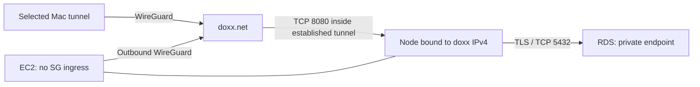
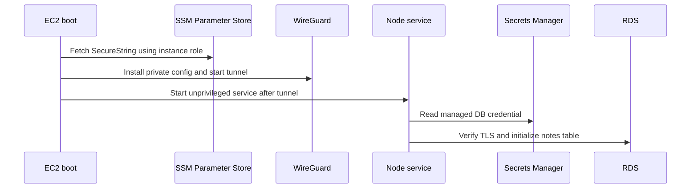
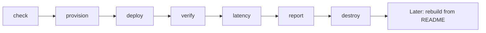
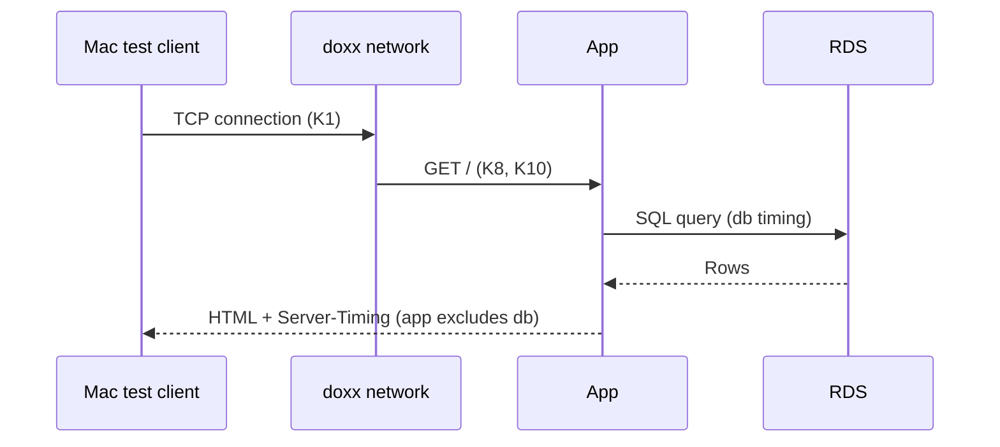

# Private notes on AWS, through doxx.net

A small Hono/Node notes app on EC2, with PostgreSQL on RDS. The EC2 security group has **zero inbound rules**. An outbound WireGuard tunnel carries requests from a selected Mac on doxx.net.

**Status: numbered Step 1 implemented locally. No cloud resources have been provisioned, no live tests have run, and no benchmark baseline exists.** HTTPS and login are separate later stages in [the plan](plans/doxx-aws-test-app.md). This version serves HTTP inside the tunnel and is for disposable test notes.

## Contents

1. [Architecture](#architecture)
2. [Prerequisites](#prerequisites)
3. [Build it](#build-it)
4. [Verify](#verify)
5. [Latency](#latency)
6. [API reference](#api-reference)
7. [Design decisions](#design-decisions)
8. [Troubleshooting](#troubleshooting)
9. [Costs and teardown](#costs-and-teardown)

## Architecture



Only the configured Mac source IP is accepted by the app, even if the account already has Link All enabled. Changing Mac tunnels requires rerunning provisioning and deployment. There is no application login yet. HTTP is carried by the doxx network; this is not independent browser-to-app TLS. RDS traffic uses TLS with certificate verification.



## Prerequisites

| Requirement | Check / setup |
|---|---|
| Node 22.9+ or 24 and npm | `node --version`; locally tested with Node 24.17.0 |
| Terraform 1.13.x or newer, below 2 | `terraform version`; locally tested with 1.13.2 |
| AWS CLI v2 and default credentials | `aws sts get-caller-identity`; requires EC2, IAM, RDS, SSM and Secrets Manager permissions |
| WireGuard on the Mac | `wg --version`; create and connect a separate Mac tunnel |
| curl, jq, tar, Bash | `make check` checks availability |
| doxx account and available tunnel seat | [Account portal](https://a0x13.doxx.net/); signup and subscription/trial are manual |
| doxx net-admin token | Create in the portal; place only in private `.env` or environment |
| Default VPC in us-east-1 | Must use `172.31.0.0/16`, public outbound routing, and subnets in at least two availability zones |

No application Docker build is needed. AWS boot installs the versioned `nodejs22` packages; see [Amazon Linux's Node documentation](https://docs.aws.amazon.com/linux/al2023/ug/nodejs.html).

## Build it

### Local implementation checks (no infrastructure changes)

```sh
make install
make test
bash scripts/package.sh
terraform -chdir=infra init -backend=false
make validate
make test-infra
make security-check
```

The application and provider versions are locked in `app/package-lock.json` and `infra/.terraform.lock.hcl`. Packaging includes only four explicitly named app files; it cannot pick up `.env`, cloud credentials, or local results. The bundle size check reserves space within EC2's user-data limit.

### Later: provision and deploy

These steps create billable resources and consume one doxx seat. They have **not** been run for this checkout.

```sh
cp .env.example .env
chmod 600 .env
cp infra/terraform.tfvars.example infra/terraform.tfvars
# Edit .env with your net-admin token, server and existing Mac tunnel name.
make servers
make tunnels
make check
make provision
make deploy
```

`make servers` shows public locations. Select a server near the AWS region explicitly; the script does not guess from hostnames. `make tunnels` displays names and connection state without keys or tokens. Connect the chosen Mac tunnel before verification. Do not paste credentials into chat or commit the populated configuration.

| Target | Raw command / behavior |
|---|---|
| `make check` | `bash scripts/check.sh`; read-only tool/config/credential preflight |
| `make provision` | `bash scripts/doxx-provision.sh`; tunnel, SecureString, per-pair rule, private deployment inputs |
| `make deploy` | `bash scripts/deploy.sh`; package, init, saved plan, explicit apply prompt |
| `make verify` | `bash scripts/verify.sh`; online checks, temporary test note and service restart |
| `make verify-offline` | `bash scripts/verify.sh --offline`; run after manually disconnecting the Mac tunnel |
| `make latency` | `node --env-file-if-exists=.env --test --test-concurrency=1 tests/latency/*.test.mjs` |
| `make report` | `node scripts/latency-report.mjs`; requires a reviewed real baseline |
| `make destroy` | `bash scripts/destroy.sh`; saved destruction plan, prompt, AWS deletion, then doxx cleanup |



Provisioning records ownership in `.local/provision.json` with mode 0600. Repeated runs reuse the named tunnel and owned SSM parameter, skip existing firewall rules, and preserve account-wide settings. A pre-existing tunnel is borrowed, not deleted at teardown. Duplicate names, changed account/region, or an unowned SSM parameter cause an error. Keep the private journal until cleanup is finished. A crash between an API mutation and its journal update can leave an untracked resource: inspect it manually; never delete it merely because its name matches.

<details>
<summary>Configuration reference</summary>

Environment values are read by Node's env-file loader; `.env` is not executed as shell code. Existing environment values take precedence.

| Variable | Default | Meaning |
|---|---|---|
| `DOXX_TOKEN` | required | net-admin credential, never sent to AWS |
| `AWS_REGION` | `us-east-1` | AWS deployment region |
| `DOXX_TUNNEL_NAME` | `aws-test-app` | Dedicated instance tunnel name |
| `DOXX_SERVER` | required | Exact discovered server hostname |
| `DEVICE_TUNNEL_NAME` | required | Existing Mac tunnel, selectable before provisioning |
| `WG_PARAMETER_NAME` | `/doxx-test-app/wg-conf` | SecureString owned by this project |
| `DOXX_ALLOWED_IPS` | `10.0.0.0/8,2602:f5c1:1::/48` | Doxx-only routes; excludes AWS VPC and default route |
| `WG_MTU` | `1380` | Conservative starting MTU, live validation still needed |
| `DIRECT_BASELINE_CONFIRMED` | unset | Set `1` only after verifying the regional baseline bypasses the Mac's doxx tunnel |
| `project_name` (Terraform) | `doxx-test-app` | Resource names and tags |
| `postgres_version` (Terraform) | `17.6` | Pinned engine; check regional availability before apply |
| `ami_id` (Terraform) | `null` | Latest AL2023 x86_64; replace with recorded output to reproduce exactly |
| `aws_region`, `wg_parameter_name` (Terraform) | above | Written by provisioning |
| `tunnel_ip`, `client_ip` (Terraform) | required | Written by provisioning; no private keys |

`infra/generated.auto.tfvars.json` is private and overrides matching values in `terraform.tfvars`. Change region, parameter, or Mac selection through `.env`, not by editing the generated file. Default AWS credential resolution is used; standard `AWS_PROFILE` is supported if intentionally set.

Runtime environment values are `BIND_HOST`, `CLIENT_IP`, `AWS_REGION`, `DB_HOST`, `DB_SECRET_ARN`, and `DB_CA_FILE`. They contain references and addresses, not passwords. The app fetches its password directly into memory. No sensitive SSM value is read by Terraform.

</details>

## Verify

`make verify` checks the app security group, DB security group, private RDS flag, connected instance tunnel, page access, reported caller IP, notes persistence across a service restart, and blocked public TCP 8080. It removes its own test note. It requires permission to send SSM commands and leaves other notes intact.

Then disconnect the Mac tunnel, run `make verify-offline`, and reconnect it. A failed connection on its own is not evidence of isolation; combine it with the successful connected test and security group inspection. Automatic tunnel switching is deliberately not performed.

For a manual note test, open the page and submit its form. Raw POSTs require the form's CSRF token. The cleanup route `POST /notes/:id/delete` has the same source-IP and CSRF checks.

| Test | Local status / live purpose |
|---|---|
| App security tests | Local: escaping, parameterized writes, body bounds, CSRF, caller-IP checks, sanitized errors |
| AWS CLI input tests | Local skeleton validation: private-file input and cleanup on success/failure; no AWS requests |
| Provisioning lifecycle tests | Local mocks: idempotency, owned cleanup, preservation of borrowed resources |
| Terraform plan test | Mock provider: zero ingress, private encrypted RDS, IMDSv2; no AWS calls |
| Config renderer tests | Local: valid split routes, rejection of injected WireGuard fields |
| Percentile/report tests | Local: known percentiles, light/dark SVG and table generation |
| `make verify` | Not yet run against AWS |
| `make verify-offline` | Not yet run; requires manual Mac disconnect |
| Boot/rebuild | Not yet validated on EC2 |

## Latency

Run `make latency` only after connected verification passes and after verifying that the regional AWS API endpoint's route bypasses doxx on the Mac. Then set `DIRECT_BASELINE_CONFIRMED=1`. A full-tunnel Mac connection otherwise makes the supposed direct baseline another doxx path.

The suite runs 200 measured samples plus 10 discarded warmups for each sequential case, ten concurrent clients for 30 seconds, and one request after 90 seconds of application silence. WireGuard keepalives continue during idle. Write samples delete their own notes outside the measured write interval. Failed operations are counted, and partial results are saved even when a threshold fails.



| Case | KPIs | Provisional target |
|---|---|---|
| TC-L1 TCP connection | K1, K3 | Report p50/p95/p99; p95 minus p50 <=20 ms |
| TC-L2 regional comparison | K2 | Median difference <=30 ms |
| TC-L3 warm health | K5, K7 | p95 <= TCP p95 +15 ms; app p95 <=5 ms |
| TC-L4 cold health | K6 | p95 <=2 × TCP p95 +20 ms |
| TC-L5 page read | K8 | DB p95 <=10 ms |
| TC-L6 note write | K9 | DB p95 <=20 ms |
| TC-L7 concurrent page reads | K10 | p95 <=2 × sequential page p95 |
| TC-L8 idle recovery | K11 | First request <= cold target |
| All operations | K4 | Zero failures |

Thresholds live in `tests/latency/thresholds.json`. The AWS API endpoint differs from the app host: K2 is an approximate regional comparison, not an isolated measurement of doxx overhead. TCP timing is a connect-time RTT proxy. Network residual includes client-side processing; component medians do not necessarily sum to the total median.

Review the real run before copying it to `results/baseline.json`. Record coarse client location and doxx server selection without account identifiers, addresses, cookies, credentials, or note contents. Calibrate provisional thresholds only once with written reasoning; preserve evidence of missed targets. `make report` generates four SVG graphs in light and dark variants and tables from the same baseline. No fabricated results or placeholder graphs are committed.

<!-- latency:start -->

No live baseline yet. Measurement and calibration belong to later plan steps.

<!-- latency:end -->

## API reference

<details>
<summary>Doxx API used by the scripts</summary>

All requests use form-encoded POSTs to `https://config.doxx.net/v1/`; authentication is in the body, never the URL or process arguments. Doxx responses containing private keys are kept in memory. The AWS CLI receives its request through a temporary 0600 JSON file inside a private directory under ignored `.local/`; the file is removed after success or failure. This avoids macOS subprocess `/dev/stdin` failures and keeps secrets out of command arguments. Errors show only sanitized message/error-code fields; complete response bodies and context are never printed. The scripts do not automatically retry mutations.

| Action | Parameters besides token | Use |
|---|---|---|
| `servers` | none, no token required | Discover locations |
| `list_tunnels` | none | Resolve selected tunnel and connection state |
| `create_tunnel` | `name`, `server`, `type=wireguard` | Allocate one tunnel seat |
| `wireguard` | `tunnel_token` | Fetch structured config |
| `firewall_rule_list` | `tunnel_token` | Read rules and Link All status |
| `firewall_rule_add` / `firewall_rule_delete` | `tunnel_token`, `protocol`, `src_ip`, `src_port`, `dst_ip`, `dst_port` | Manage only owned TCP 8080 rules |
| `delete_tunnel` | `tunnel_token` | Delete owned tunnel |

Use a net-admin token for mutations. References: [authentication](https://github.com/doxxcorp/config.doxx.net), [tunnels](https://github.com/doxxcorp/config.doxx.net/blob/main/docs/endpoints/tunnels.md), [firewall](https://github.com/doxxcorp/config.doxx.net/blob/main/docs/endpoints/firewall.md), [servers](https://github.com/doxxcorp/config.doxx.net/blob/main/docs/endpoints/servers.md). Documentation reviewed 2026-10-12; authenticated behavior has not been verified live.

| Remaining unknown | Validation needed |
|---|---|
| Actual assigned addresses and schema | Provisioning validates responses; do not infer from docs examples |
| AWS WireGuard compatibility and MTU | Live handshake, small and large response tests |
| Default VPC outbound routing | Confirm public subnet route and internet gateway before deployment |
| Mac DNS/routes | Verify tunnel connectivity and independent regional baseline path |

</details>

## Design decisions

| Choice | Alternative | Reason |
|---|---|---|
| Private RDS | PostgreSQL on EC2 / DynamoDB | Demonstrates a managed private database behind the app |
| Runtime secret fetch | Secrets embedded in Terraform/user data | Keeps key material and passwords out of state and source |
| Split tunnel | Full tunnel on EC2 | Preserves metadata, VPC DNS and AWS API access |
| Dedicated per-pair rule | Change Link All | Preserves existing account configuration |
| App source-IP check | Rely only on doxx firewall | Restricts caller even when Link All is already enabled |
| Small explicit app archive | Git clone at boot | Reproducible source without GitHub credentials on EC2 |

<details>
<summary>Security and public repository boundary</summary>

- `.env`, `.local`, generated WireGuard configs, Terraform variables/state/plans and raw results are ignored. Keep state and the ownership journal private even though secret values are kept out of Terraform.
- AWS IAM allows the required WireGuard parameter and managed DB secret reads. The standard SSM managed policy is attached for administration; it has AWS-defined permissions beyond these two custom statements. This is a disposable single-instance demo, not a complete production least-privilege design.
- No inbound SSH, public HTTP rule, ALB, NAT gateway or public database. The instance's public IPv4 is for outbound connectivity.
- App code runs as an unprivileged user. AWS role credentials are supplied by IMDSv2. DB credentials are fetched at startup; after managed password rotation, restart the service to refresh them.
- Public output should include source, lockfiles, example inputs, and sanitized measurement data only. Review any generated baseline before committing. Run `make security-check` before publication.
- Login and independent HTTPS are deferred. Do not use real personal information or sensitive notes in this stage. The DB is intentionally deleted without a final snapshot.

</details>

## Troubleshooting

| Symptom | Check |
|---|---|
| Tool cannot resolve external domains | Network/sandbox configuration; dependency download and provider validation may need host access |
| Tunnel name rejected | `make tunnels`; names must be unique and Mac/app tunnels distinct |
| AWS SSM write denied | The sanitized error identifies IAM/credential failures; check `ssm:PutParameter`, tagging permissions and any applicable KMS policy |
| Existing SSM parameter rejected | Use a unique parameter path; do not overwrite unrelated secrets |
| Instance unavailable | Wait for RDS and cloud-init, then use `aws ssm start-session --target <instance-id>` |
| Tunnel down | Privately inspect `sudo wg show` and `journalctl -u wg-quick@doxx`; never publish config output |
| Service unavailable | `journalctl -u doxx-app`; check DB connectivity, CA and secret permissions |
| 403 from app | Mac tunnel changed, source address differs, or CSRF token is stale after restart |
| Large responses stall | Revisit MTU and routes; 1380 is provisional |
| RDS version unavailable | Select a supported exact version in `terraform.tfvars`, document the change |
| Boot package install fails | Check pinned AMI and AL2023 nodejs22 package availability |
| Cleanup interrupted | Retain local state/journal, inspect owned resources, then rerun cleanup |

## Costs and teardown

This configuration uses one `t3.micro`, one single-AZ `db.t4g.micro` with 20 GB gp3 storage, an 8 GB EC2 root disk, one public IPv4, a managed DB secret, a WireGuard SecureString, and one doxx seat. Actual charges also depend on runtime and transfer. The original plan's estimate is provisional and omits some line items; confirm current regional prices before applying. No spending cap is enforced by these scripts.

| Resource | Cost treatment |
|---|---|
| EC2 and public IPv4 | Billed while allocated/running under applicable AWS pricing |
| RDS compute and storage | Billed during the test; creation may take several minutes |
| Secrets Manager | Managed DB secret has applicable storage/API charges |
| Network and doxx seat | Depends on AWS transfer and the doxx subscription |

Run `make destroy` after tests. It displays a destruction plan and asks for `destroy`, then removes AWS resources before deleting owned doxx rules, tunnel, and SecureString. Database contents are permanently discarded. If provisioning succeeded but Terraform was never applied, use `bash scripts/doxx-teardown.sh` to clean up doxx/SSM only. Never run that standalone cleanup while an instance still depends on the tunnel.

Reproduction, actual cost recording, Git initialization/commit, HTTPS, login, and final cleanup are later plan steps; none is represented as already completed here.
